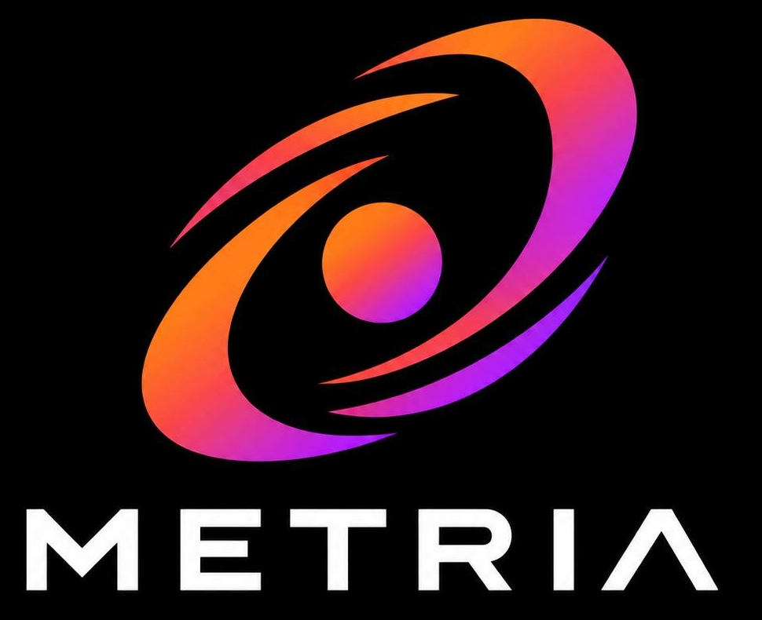

# METRIA



> **Every launch. Every transition. Verified.**  
> Independent, read-only evidence for Meteora Dynamic Bonding Curve (DBC) pool state and migration.

[](https://nextjs.org/)
[](https://meteora.ag)
[](LICENSE)

METRIA is an independent builder project for the Meteora ecosystem. It is not an official Meteora product. It reads Solana account and transaction data; it does not sign or submit transactions.

## What it verifies

METRIA uses Meteora's DBC SDK to decode supported virtual-pool and configuration accounts. For the supported DAMM v2 route it checks the successful migration instruction, derives and decodes the destination with the installed official SDK, and separately evaluates historical token flow. A threshold, matching mint pair, or derived destination alone is not proof of migration. Current vault balances are point-in-time observations and do not establish continuing liquidity.

Supported IDs are kept distinct:

| Program | Program ID | Role |
| --- | --- | --- |
| Meteora DBC | `dbcij3LWUppWqq96dh6gJWwBifmcGfLSB5D4DuSMaqN` | DBC virtual pools and configuration |
| Meteora DAMM v1 | `Eo7WjKq67rjJQSZxS6z3YkapzY3eMj6Xy8X5EQVn5UaB` | Legacy destination; not DBC or DAMM v2 |
| Meteora DAMM v2 | `cpamdpZCGKUy5JxQXB4dcpGPiikHawvSWAd6mEn1sGG` | Supported migration destination |
| Raydium CPMM | `CPMMoo8L3F4NbTegBCKVNunggL7H1ZpdTHKxQB5qKP1C` | Separate protocol; never treated as Meteora DAMM v2 |

Program IDs are checked against the [Meteora DBC guide](https://docs.meteora.ag/developer-guides/dbc), [DBC program source](https://github.com/MeteoraAg/dynamic-bonding-curve), [DBC TypeScript SDK](https://github.com/MeteoraAg/dynamic-bonding-curve-sdk), [DAMM v2 guide](https://docs.meteora.ag/developer-guides/damm-v2), and [DAMM v2 source](https://github.com/MeteoraAg/damm-v2). DLMM is not implemented in METRIA. See [Technical Audit](docs/TECHNICAL_AUDIT.md) and [Known Limitations](docs/KNOWN_LIMITATIONS.md) for verification scope and evidence.

## Requirements and setup

- Node.js 20 or newer (Node.js 22 tested in CI)
- npm 10 or newer

```bash
git clone https://github.com/accurastnya-hash/METRIA.git
cd METRIA
npm ci
cp .env.example .env.local
npm run dev
```

PowerShell equivalent for copying the optional local environment file:

```powershell
Copy-Item .env.example .env.local
npm run dev
```

Open `http://localhost:3000`. The default RPC endpoints are public Solana endpoints. Optional RPC URL overrides are listed in [.env.example](.env.example); do not put credentials in `NEXT_PUBLIC_*` variables or commit `.env.local`.

## Validation commands

```bash
# Deterministic unit and mocked route tests; no Mainnet RPC required
npm run test:unit

# Optional read-only Mainnet checks; depends on public RPC availability
npm run test:live

# Complete Vitest suite, including live checks
npm test

npm run typecheck
npm run lint
npm run build
npm run docs:check

# Enforced security audit gate (fail-closed check with approved dev exception)
npm run audit:gate

# Production dependency audit (must be 0 vulnerabilities)
npm audit --omit=dev
```

The CI workflow runs deterministic tests and does not require live RPC. Live Mainnet validation is a separate manually dispatched workflow. The number of tests changes over time; see [the test report](docs/TEST_REPORT.md) for the latest recorded run and exact command output.

## API

- `GET /api/v1/verification/:address` — verification result and a receipt for that request.
- `GET /api/v1/pools/:address` — decoded DBC pool fields; rejects addresses that do not resolve to a DBC pool.
- `GET /api/v1/receipts/:receiptId` — lookup in the built-in simulated fixture catalog only. Live receipts are not persisted.
- `GET /api/v1/health` — process liveness and methodology metadata; it does not probe RPC health.

For local examples and field semantics see [API documentation](docs/API.md). Set `NEXT_PUBLIC_APP_URL` to the public application origin to configure the API docs page; otherwise it uses the current origin in a browser and localhost during prerendering. Unsupported query parameters and malformed clusters return HTTP 400. HTTP 200 from verification does not mean `VERIFIED`; clients must inspect the response status and claims.

## Readiness and evidence

**Readiness: READY FOR SIMULATED DEMO ONLY.** Local deterministic and live Mainnet tests, type checking, lint, build, documentation-link validation, and the fail-closed security audit gate passed. Production dependencies report 0 vulnerabilities (`npm audit --omit=dev` exits 0). Full `npm audit` reports 5 high vulnerability records deriving strictly from the single dev-tooling advisory `GHSA-vfj7-8cjw-p6xm` (`braces@3.0.3` in `eslint-config-next`), for which a narrow, temporary development-tooling exception has been approved by the maintainer through 2026-11-10. This approval is a temporarily accepted development-tooling risk, not a claim that `braces` has been patched. Overrides for `jayson@5.0.0` (outside `@solana/web3.js@1.99.0`'s declared range) and `@exodus/bigint-buffer` provide project-tested compatibility, not a guarantee of upstream support for all Web3.js features. Publication remains blocked until the maintainer completes the final review and separately authorizes publication.

- [Dependency security audit](docs/DEPENDENCY_SECURITY_AUDIT.md)
- [Technical audit](docs/TECHNICAL_AUDIT.md)
- [Fresh Mainnet validation](docs/REAL_MAINNET_VALIDATION.md)
- [Test report](docs/TEST_REPORT.md)
- [Known limitations](docs/KNOWN_LIMITATIONS.md)
- [Architecture](docs/ARCHITECTURE.md)
- [Demo runbook](docs/DEMO_RUNBOOK.md)

## Security

Report vulnerabilities through GitHub's private vulnerability reporting for this repository. Review [SECURITY.md](SECURITY.md) before reporting. Do not open a public issue with credentials or exploitable details.

## License

Licensed under the [Apache License 2.0](LICENSE).
